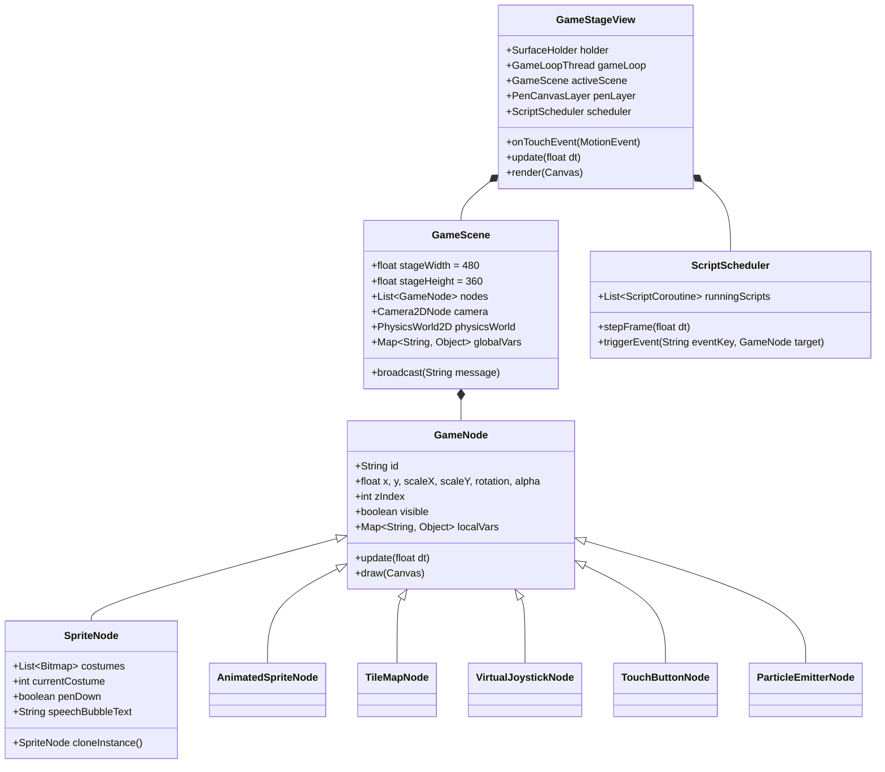

# Arquitetura Técnica: Motor de Jogos 2D (Scratch 3) Integrado ao Sketchware-IA

## 1. Localização do "Open Craft" (FigCraft) no Computador

O aplicativo que você utiliza para prototipação de telas (**FigCraft** / "open craft") foi localizado na sua máquina nos seguintes caminhos:

- **Executável GUI:** `C:\Users\kirit\AppData\Local\FigCraft-0.16.0\figcraft-0.16.0-windows-x64-portable\figcraft.exe`
- **Executável CLI / Automação JSON / MCP:** `C:\Users\kirit\AppData\Local\FigCraft-0.16.0\figcraft-0.16.0-windows-x64-portable\figcraft-cli.exe`
- **Diretório de Dados e Logs:** `C:\Users\kirit\AppData\Local\FigCraft\`

> [!TIP]
> Podemos utilizar o `figcraft-cli.exe` a qualquer momento para gerar ou atualizar os protótipos visuais da nova tela de edição do motor de jogos 2D seguindo exatamente os tokens visuais do Sketchware-IA.

---

## 2. Análise Profunda do Código-Fonte do Sketchware-IA

Antes de propor a arquitetura do motor **Game 2D**, mapeamos toda a estrutura real do repositório **Sketchware-IA** (`c:\Users\kirit\AndroidStudioProjects\Sketchware\Sketchware-IA`), verificando as classes solicitadas e todas as suas dependências diretas.

### 2.1. Diagnóstico das 5 Classes Base Solicitadas

| Classe | Caminho Real no Projeto | Papel Atual na Arquitetura | Ponto de Extensão Identificado |
| :--- | :--- | :--- | :--- |
| [`BuiltInWidgets`](file:///C:/Users/kirit/AndroidStudioProjects/Sketchware/Sketchware-IA/app/src/main/java/pro/sketchware/widgets/BuiltInWidgets.java#L29-L226) | `pro/sketchware/widgets/BuiltInWidgets.java` | Catálogo estático de `Preset`s divididos em `Section` (`LAYOUTS`, `ANDROIDX_LAYOUTS`, `WIDGETS`, `MATERIAL_WIDGETS`), com `Supplier<ViewBean>` e `Requirement`s. | Permite adicionar seções dedicadas ao modo Game 2D (`GAME_STAGE`, `GAME_OBJECTS`, `GAME_PHYSICS`, `GAME_CONTROLS_HUD`) ou um catálogo paralelo `BuiltInGameWidgets` consumido pelo `ViewEditorFragment`. |
| [`WidgetsCreatorManager`](file:///C:/Users/kirit/AndroidStudioProjects/Sketchware/Sketchware-IA/app/src/main/java/pro/sketchware/widgets/WidgetsCreatorManager.java#L29-L295) | `pro/sketchware/widgets/WidgetsCreatorManager.java` | Carrega widgets customizados baseados em JSON (`/storage/emulated/0/.sketchware/resources/widgets/widgets.json`) e os injeta em [`ViewEditorFragment.e()`](file:///C:/Users/kirit/AndroidStudioProjects/Sketchware/Sketchware-IA/app/src/main/java/a/a/a/ViewEditorFragment.java#L220-L310). | Demonstra como injetar categorias e itens dinâmicos em [`PaletteWidget`](file:///C:/Users/kirit/AndroidStudioProjects/Sketchware/Sketchware-IA/app/src/main/java/com/besome/sketch/editor/view/palette/PaletteWidget.java) sem quebrar os widgets Android tradicionais. |
| [`ViewEditor`](file:///C:/Users/kirit/AndroidStudioProjects/Sketchware/Sketchware-IA/app/src/main/java/com/besome/sketch/editor/view/ViewEditor.java#L106-L1397) | `com/besome/sketch/editor/view/ViewEditor.java` | Canvas visual principal (`R.layout.view_editor`). Gerencia paleta lateral (`paletteWidget`, `paletteFavorite`), moldura do dispositivo (`shape`, `viewPane`), drag-and-drop via `longPressed` (`IconBase`), **movimentação livre em canvas (`canFreeMove`, `updateFreeMove`, `finishFreeMove`)**, guias de alinhamento (`RelationsOverlay`), geração de IDs (`generateWidgetId`) e histórico Undo/Redo (`cC`). | **Já possui motor de arraste livre em coordenadas (X, Y) em dp** para `RelativeLayout` / `ConstraintLayout`! Ao usar um container raiz de cena (`GameSceneLayout` ou `Stage` baseado em `FrameLayout`/`RelativeLayout` com posicionamento livre), 90% da mecânica de arrastar, mover, selecionar e excluir já está pronta. |
| [`ViewBean`](file:///C:/Users/kirit/AndroidStudioProjects/Sketchware/Sketchware-IA/app/src/main/java/com/besome/sketch/beans/ViewBean.java#L24-L250) | `com/besome/sketch/beans/ViewBean.java` | Modelo serializável de cada elemento na tela (`id`, `name`, `type`, `parent`, `parentType`, `index`, `layout` [`LayoutBean`], `text` [`TextBean`], `image` [`ImageBean`], `alpha`, `translationX`, `translationY`, `scaleX`, `scaleY`, `convert`, `inject`, `customView`, `classInfo` [`Gx`]). Delega tipos ≥ 19 para [`ViewBeans`](file:///C:/Users/kirit/AndroidStudioProjects/Sketchware/Sketchware-IA/app/src/main/java/mod/agus/jcoderz/beans/ViewBeans.java#L8-L590). | Já armazena coordenadas (`marginLeft`/`marginTop`, `translationX`/`Y`), escala (`scaleX`/`Y`), rotação (`image.rotate`), transparência (`alpha`), imagem (`image.resName`), texto (`text`) e atributos extras (`inject` / `parentAttributes`). Podemos reservar a faixa de tipos `200–220` em [`ViewBeans`](file:///C:/Users/kirit/AndroidStudioProjects/Sketchware/Sketchware-IA/app/src/main/java/mod/agus/jcoderz/beans/ViewBeans.java) para os componentes de Game 2D. |
| [`IconBase`](file:///C:/Users/kirit/AndroidStudioProjects/Sketchware/Sketchware-IA/app/src/main/java/com/besome/sketch/editor/view/palette/IconBase.java#L10-L34) | `com/besome/sketch/editor/view/palette/IconBase.java` | Classe base (`extends BaseWidget`) de todos os itens arrastáveis da paleta. O método `getBean()` fabrica o `ViewBean` correspondente quando o usuário solta o item no [`ViewPane`](file:///C:/Users/kirit/AndroidStudioProjects/Sketchware/Sketchware-IA/app/src/main/java/com/besome/sketch/editor/view/ViewPane.java). | Criar `IconGameWidget extends IconBase` permite adicionar todos os 13 componentes de jogo na mesma `PaletteWidget` com suporte imediato a drag-and-drop e Favoritos (`PaletteFavorite`). |

---

### 2.2. Mapeamento Completo dos Demais Subsistemas Investigados

1. **Gerenciamento e Tipos de Projeto ([`lC.java`](file:///C:/Users/kirit/AndroidStudioProjects/Sketchware/Sketchware-IA/app/src/main/java/a/a/a/lC.java#L31-L260), [`ProjectsFragment.java`](file:///C:/Users/kirit/AndroidStudioProjects/Sketchware/Sketchware-IA/app/src/main/java/pro/sketchware/activities/main/fragments/projects/ProjectsFragment.java#L270-L315), [`MyProjectSettingActivity.java`](file:///C:/Users/kirit/AndroidStudioProjects/Sketchware/Sketchware-IA/app/src/main/java/com/besome/sketch/projects/MyProjectSettingActivity.java#L110-L240))**:
   - [`lC.java`](file:///C:/Users/kirit/AndroidStudioProjects/Sketchware/Sketchware-IA/app/src/main/java/a/a/a/lC.java#L33-L35) define a chave `PROJECT_KIND_KEY = "project_kind"` com os valores `"sketchware"` (Nativo) e `"android_studio"` (Android Studio).
   - [`ProjectsFragment.showNewProjectTypeDialog()`](file:///C:/Users/kirit/AndroidStudioProjects/Sketchware/Sketchware-IA/app/src/main/java/pro/sketchware/activities/main/fragments/projects/ProjectsFragment.java#L276-L304) infla [`dialog_new_project_type.xml`](file:///C:/Users/kirit/AndroidStudioProjects/Sketchware/Sketchware-IA/app/src/main/res/layout/dialog_new_project_type.xml#L1-L98) e abre [`MyProjectSettingActivity`](file:///C:/Users/kirit/AndroidStudioProjects/Sketchware/Sketchware-IA/app/src/main/java/com/besome/sketch/projects/MyProjectSettingActivity.java) passando `EXTRA_PROJECT_KIND`.
   - Ao clicar em um projeto na lista, o adapter verifica `lC.isAndroidStudioProject(map)` para decidir entre abrir [`DesignActivity`](file:///C:/Users/kirit/AndroidStudioProjects/Sketchware/Sketchware-IA/app/src/main/java/com/besome/sketch/design/DesignActivity.java) ou [`AndroidStudioProjectActivity`](file:///C:/Users/kirit/AndroidStudioProjects/Sketchware/Sketchware-IA/app/src/main/java/pro/sketchware/activities/studio/AndroidStudioProjectActivity.java).

2. **Arquitetura do Editor Visual e Painel de Propriedades ([`DesignActivity.java`](file:///C:/Users/kirit/AndroidStudioProjects/Sketchware/Sketchware-IA/app/src/main/java/com/besome/sketch/design/DesignActivity.java#L170-L350), [`ViewEditorFragment.java`](file:///C:/Users/kirit/AndroidStudioProjects/Sketchware/Sketchware-IA/app/src/main/java/a/a/a/ViewEditorFragment.java#L60-L340), [`ViewPane.java`](file:///C:/Users/kirit/AndroidStudioProjects/Sketchware/Sketchware-IA/app/src/main/java/com/besome/sketch/editor/view/ViewPane.java#L128-L250), [`ViewProperty.java`](file:///C:/Users/kirit/AndroidStudioProjects/Sketchware/Sketchware-IA/app/src/main/java/com/besome/sketch/editor/view/ViewProperty.java#L48-L250))**:
   - [`DesignActivity`](file:///C:/Users/kirit/AndroidStudioProjects/Sketchware/Sketchware-IA/app/src/main/java/com/besome/sketch/design/DesignActivity.java) organiza a IDE em 4 abas no `ViewPager`: **View** (`ViewEditorFragment`), **Event** (`rs`), **Component** (`br`) e **Strings** (`StringsTabFragment`), além de uma gaveta inferior retrátil [`ViewProperty`](file:///C:/Users/kirit/AndroidStudioProjects/Sketchware/Sketchware-IA/app/src/main/java/com/besome/sketch/editor/view/ViewProperty.java) que alterna entre **Propriedades Básicas** (`selectedGroupId == 0`), **Propriedades Recentes** (`1`) e **Eventos do Widget** (`2`).
   - [`ViewPane`](file:///C:/Users/kirit/AndroidStudioProjects/Sketchware/Sketchware-IA/app/src/main/java/com/besome/sketch/editor/view/ViewPane.java) instancia uma subclasse visual `Item*` (implementando a interface `sy`) para cada `ViewBean.type`.

3. **Persistência de Projetos, Layouts, Blocos e Recursos ([`jC.java`](file:///C:/Users/kirit/AndroidStudioProjects/Sketchware/Sketchware-IA/app/src/main/java/a/a/a/jC.java#L1-L128))**:
   - `jC.a(sc_id)` (`eC`): Gerencia arquivos `view` (hierarquia de `ViewBean`s por tela XML) e `logic` (`BlockBean`s, variáveis, listas, eventos `EventBean` e componentes `ComponentBean` por arquivo Java) em `.sketchware/data/<sc_id>/`.
   - `jC.b(sc_id)` (`hC`): Gerencia a lista de telas/arquivos (`ProjectFileBean` em `file`).
   - `jC.c(sc_id)` (`iC`): Gerencia bibliotecas nativas (`library`).
   - `jC.d(sc_id)` (`kC`): Gerencia recursos (`image`, `sound`, `font`, `file`) em `.sketchware/resources/<tipo>/<sc_id>/`.

4. **Sistema de Blocos Visuais e Geração de Código Java ([`BlockBean.java`](file:///C:/Users/kirit/AndroidStudioProjects/Sketchware/Sketchware-IA/app/src/main/java/com/besome/sketch/beans/BlockBean.java#L15-L190), [`LogicEditorActivity.java`](file:///C:/Users/kirit/AndroidStudioProjects/Sketchware/Sketchware-IA/app/src/main/java/com/besome/sketch/editor/LogicEditorActivity.java#L140-L250), [`PaletteSelector.java`](file:///C:/Users/kirit/AndroidStudioProjects/Sketchware/Sketchware-IA/app/src/main/java/com/besome/sketch/editor/logic/PaletteSelector.java#L28-L175), [`Gx.java`](file:///C:/Users/kirit/AndroidStudioProjects/Sketchware/Sketchware-IA/app/src/main/java/a/a/a/Gx.java#L5-L250), [`mq.java`](file:///C:/Users/kirit/AndroidStudioProjects/Sketchware/Sketchware-IA/app/src/main/java/a/a/a/mq.java#L12-L250), [`Fx.java`](file:///C:/Users/kirit/AndroidStudioProjects/Sketchware/Sketchware-IA/app/src/main/java/a/a/a/Fx.java#L24-L250), [`Hx.java`](file:///C:/Users/kirit/AndroidStudioProjects/Sketchware/Sketchware-IA/app/src/main/java/a/a/a/Hx.java#L17-L250), [`Jx.java`](file:///C:/Users/kirit/AndroidStudioProjects/Sketchware/Sketchware-IA/app/src/main/java/a/a/a/Jx.java#L35-L250))**:
   - **Nota histórica fundamental:** O motor de blocos do próprio Sketchware (`BlockPane`, `Rs`, `BlockBean`, `PaletteBlock`) **já é um derivado direto do MIT Scratch 2.0 / Blockly Android**!
   - Os formatos (`BlockBean.type`) no Sketchware seguem exatamente a notação do Scratch:
     - `" "` (espaço): Bloco de comando empilhável (stack block)
     - `"c"`: Bloco de controle em "C" com 1 sub-pilha (`subStack1`, ex: `repeat`, `forever`, `if`)
     - `"e"`: Bloco em "E" com 2 sub-pilhas (`subStack1` e `subStack2`, ex: `if / else`)
     - `"f"`: Bloco finalizador sem saída inferior (cap block, ex: `stop all`, `delete this clone`)
     - `"d"` / `"n"`: Bloco reporter numérico arredondado (`double`)
     - `"s"`: Bloco reporter de texto (`String`)
     - `"b"`: Bloco booleano hexagonal (`boolean`)
     - `"h"`: Bloco chapéu de topo (hat block, usado na raiz de cada evento no `BlockPane`)
   - As entradas na string `spec` usam:
     - `%d` (número), `%s` (texto), `%b` (booleano), `%m.<menu>` (seletor dropdown de sprites, sons, fantasias, teclas, cenas, mensagens, cores, variáveis ou listas).

5. **Compilação e Empacotamento de APK ([`DesignActivity.BuildTask`](file:///C:/Users/kirit/AndroidStudioProjects/Sketchware/Sketchware-IA/app/src/main/java/com/besome/sketch/design/DesignActivity.java#L1607-L1805), `ProjectBuilder`)**:
   - O pipeline em [`DesignActivity.BuildTask.doInBackground()`](file:///C:/Users/kirit/AndroidStudioProjects/Sketchware/Sketchware-IA/app/src/main/java/com/besome/sketch/design/DesignActivity.java#L1650-L1769) executa:
     1. Extração de ícones, imagens (`drawable-xhdpi`), sons (`res/raw`) e fontes (`assets/fonts`).
     2. Geração de XMLs e classes Java via `q.b(fileManager, dataManager, libraryManager, ...)` (que invoca `Jx`, `Hx`, `Fx`, `Ox`).
     3. Extração de bibliotecas embutidas (`BuiltInLibraries.extractCompileAssets`).
     4. Compilação de recursos (`AAPT2`), geração opcional de ViewBinding, compilação Kotlin/Java (ECJ), D8/DX (`createDexFilesFromClasses`, `getDexFilesReady`), empacotamento (`buildApk`) e assinatura (`signDebugApk`).

---

## 3. Visão Geral da Solução Arquitetural: Projeto "Game 2D"

Para atender ao requisito fundamental (**preservar 100% os projetos Android tradicionais e usar a mesma interface nativa de edição do Sketchware**), a solução adota a estratégia de **Herança e Especialização Modular**:

```mermaid
flowchart TD
    PF["ProjectsFragment<br/>(dialog_new_project_type.xml)"] -->|1. Nativo| SW["project_kind = 'sketchware'<br/>DesignActivity (Intacto)"]
    PF -->|2. Android Studio| AS["project_kind = 'android_studio'<br/>AndroidStudioProjectActivity (Intacto)"]
    PF -->|3. Game 2D (NOVO)| GM["project_kind = 'game_2d'<br/>GameDesignActivity (extends DesignActivity)"]

    subgraph Game2DEditor["GameDesignActivity (Mesma UI/UX Nativa do DesignActivity)"]
        TabScene["Aba 1: Cena / Stage<br/>(ViewEditor + ViewPane em Modo Stage 2D)"]
        TabEvents["Aba 2: Eventos & Scripts<br/>(rs + LogicEditorActivity com Paleta Scratch 3)"]
        TabObjects["Aba 3: Sprites, Fantasias & Sons<br/>(Gerenciador Integrado de Objetos/Recursos)"]
        TabStrings["Aba 4: Configs de Jogo / Física<br/>(Resolução, FPS, Gravidade, Camadas)"]
    end

    GM --> Game2DEditor
    Game2DEditor -->|Botão Preview Instantâneo| Preview["GamePreviewDialog / Activity<br/>(Interpretador AST em Tempo Real)"]
    Game2DEditor -->|Botão Run (Compilar APK)| Compiler["GameCodeGenerator (Jx/Fx) +<br/>Runtime 'sketchware-game2d-runtime'<br/>-> ProjectBuilder -> APK Nativo 60 FPS"]
```

### Por que criar `GameDesignActivity` (estendendo ou compartilhando a base de `DesignActivity`)?
1. **Risco Zero para Projetos Tradicionais:** Projetos com `project_kind = "sketchware"` continuam abrindo `DesignActivity` sem qualquer alteração no seu fluxo.
2. **100% da Identidade Visual do Sketchware:** `GameDesignActivity` reutiliza o mesmo layout (`design.xml`), `Toolbar`, `CustomViewPager`, `ViewEditor`, `PaletteWidget`, `ViewPane`, `ViewProperty`, `PropertyActivity` e `LogicEditorActivity`, apenas configurando o modo `isGame2DProject = true`.
3. **Interoperabilidade Nativa + Jogo:** Como um projeto `game_2d` usa a mesma estrutura `.sketchware/data/<sc_id>/` e `.sketchware/resources/<sc_id>/`, um jogo pode conter múltiplas **Cenas (`Scene`)** (armazenadas como entradas em `ProjectFileBean`, assim como Activities) e até mesmo misturar uma Activity de Menu tradicional com uma Cena de Jogo!

---

## 4. Novo Tipo de Projeto e Fluxo de Criação

### 4.1. Alterações no Seletor de Novo Projeto
1. **[`lC.java`](file:///C:/Users/kirit/AndroidStudioProjects/Sketchware/Sketchware-IA/app/src/main/java/a/a/a/lC.java#L33-L35)**:
   - Adicionar a constante:
     ```java
     public static final String PROJECT_KIND_GAME_2D = "game_2d";
     ```
   - Adicionar o helper `public static boolean isGame2DProject(HashMap<String, Object> projectMap)`.
2. **[`dialog_new_project_type.xml`](file:///C:/Users/kirit/AndroidStudioProjects/Sketchware/Sketchware-IA/app/src/main/res/layout/dialog_new_project_type.xml)**:
   - Adicionar o 3º card `@+id/project_type_game_2d` ("Game 2D / Scratch Engine") com ícone de controle de videogame (`ic_gamepad` / Lucide Gamepad2) usando os mesmos estilos `@drawable/bg_chat_option_row`, `@drawable/bg_chat_project_icon` e `@color/chat_accent`.
3. **[`ProjectsFragment.java`](file:///C:/Users/kirit/AndroidStudioProjects/Sketchware/Sketchware-IA/app/src/main/java/pro/sketchware/activities/main/fragments/projects/ProjectsFragment.java#L276-L304) e [`ProjectsAdapter.java`](file:///C:/Users/kirit/AndroidStudioProjects/Sketchware/Sketchware-IA/app/src/main/java/pro/sketchware/activities/main/fragments/projects/ProjectsAdapter.java)**:
   - No `showNewProjectTypeDialog()`, vincular `project_type_game_2d` para chamar `openNewProjectSettings(lC.PROJECT_KIND_GAME_2D)`.
   - No `ProjectsAdapter`, exibir um badge discreto `"GAME 2D"` no card do projeto e rotear o clique para `GameDesignActivity` (ou `DesignActivity` com `EXTRA_IS_GAME_2D = true`).
4. **[`MyProjectSettingActivity.java`](file:///C:/Users/kirit/AndroidStudioProjects/Sketchware/Sketchware-IA/app/src/main/java/com/besome/sketch/projects/MyProjectSettingActivity.java)**:
   - Quando `projectKind.equals(lC.PROJECT_KIND_GAME_2D)`:
     - Gravar `project_kind = "game_2d"` no arquivo `project`.
     - Inicializar automaticamente a Cena principal (`main.xml` / `MainScene`) com um `GameCanvas` (`Stage`) configurado em tela cheia, orientação padrão selecionável (Paisagem/Retrato) e um `Sprite` inicial ("Actor1") no centro do Stage (`x = 0, y = 0`), exatamente como o Scratch faz ao criar um projeto novo.

---

## 5. Editor Visual de Cenas (Stage) e Arrastar e Soltar

### 5.1. O Stage 2D dentro do `ViewEditor` / `ViewPane`
No Sketchware tradicional, o [`ViewEditor`](file:///C:/Users/kirit/AndroidStudioProjects/Sketchware/Sketchware-IA/app/src/main/java/com/besome/sketch/editor/view/ViewEditor.java) exibe a moldura do aparelho (`shape`) com a barra de status (`bgStatus`), `toolbar` e `viewPane`.
No modo **Game 2D**:
- O `bgStatus` e a `toolbar` da moldura são ocultados por padrão (modo Fullscreen Game Stage), exibindo uma grade cartesiana sutil opcional (com centro `(0, 0)` estilo Scratch ou canto superior esquerdo `(0, 0)`, alternável na barra superior do editor) e um botão rápido de alternância **Retrato / Paisagem** (girando a moldura `shape` no `ViewEditor`).
- Abaixo ou ao lado do Stage (integrado à barra de seleção de widgets do `ViewProperty`), exibimos a **Faixa Rápida de Sprites e Objetos da Cena** (miniaturas dos Sprites, TileMaps, Câmera e HUD presentes na cena) para seleção rápida com 1 toque, duplicação, visibilidade (olho) e bloqueio de camada.

### 5.2. Novos Componentes da Paleta (Faixa `ViewBeans` 200–212)

Todos os 13 componentes solicitados são registrados em [`ViewBeans.java`](file:///C:/Users/kirit/AndroidStudioProjects/Sketchware/Sketchware-IA/app/src/main/java/mod/agus/jcoderz/beans/ViewBeans.java) (IDs `200` a `212`) e instanciados via subclasses `IconGameWidget extends IconBase` na [`PaletteWidget`](file:///C:/Users/kirit/AndroidStudioProjects/Sketchware/Sketchware-IA/app/src/main/java/com/besome/sketch/editor/view/palette/PaletteWidget.java) divididos em 4 seções na paleta esquerda:

| Seção da Paleta | Tipo (`ViewBeans`) | Nome do Componente | Classe Visual no Editor (`ViewPane`) | Classe no Runtime do Jogo (`game2d.runtime`) |
| :--- | :---: | :--- | :--- | :--- |
| **Cena & Mundo** | `200` | `Canvas / GameView` | `ItemGameCanvas` | `GameStageView` |
| **Cena & Mundo** | `201` | `TileMap` | `ItemTileMap` | `TileMapNode` |
| **Cena & Mundo** | `202` | `Camera2D` | `ItemCamera2D` | `Camera2DNode` |
| **Sprites & Visuais** | `203` | `Sprite` | `ItemSprite` | `SpriteNode` |
| **Sprites & Visuais** | `204` | `AnimatedSprite` | `ItemAnimatedSprite` | `AnimatedSpriteNode` |
| **Sprites & Visuais** | `205` | `ParticleEmitter` | `ItemParticleEmitter` | `ParticleEmitterNode` |
| **Física & Colisão** | `206` | `PhysicsBody2D` | `ItemPhysicsBody2D` | `PhysicsBody2DNode` |
| **Física & Colisão** | `207` | `CollisionShape` | `ItemCollisionShape` | `CollisionShapeNode` |
| **Controles, HUD & Áudio** | `208` | `Joystick` | `ItemJoystick` | `VirtualJoystickNode` |
| **Controles, HUD & Áudio** | `209` | `TouchButton` | `ItemTouchButton` | `TouchButtonNode` |
| **Controles, HUD & Áudio** | `210` | `Text / HUD` | `ItemHudText` | `HudTextNode` |
| **Controles, HUD & Áudio** | `211` | `AudioPlayer` | `ItemAudioPlayer` | `AudioPlayerNode` |
| **Controles, HUD & Áudio** | `212` | `Timer` | `ItemGameTimer` | `GameTimerNode` |

### 5.3. Manipulação Visual no Stage (Mover, Redimensionar, Girar, Duplicar, Camadas)
Aproveitando o motor `canFreeMove` / `updateFreeMove` / `finishFreeMove` já existente em [`ViewEditor.java`](file:///C:/Users/kirit/AndroidStudioProjects/Sketchware/Sketchware-IA/app/src/main/java/com/besome/sketch/editor/view/ViewEditor.java#L440-L610) e o [`LayoutRelationsOverlay`](file:///C:/Users/kirit/AndroidStudioProjects/Sketchware/Sketchware-IA/app/src/main/java/com/besome/sketch/editor/view/ViewPane.java#L205-L215):
- **Seleção e Arraste Livre:** Arrastar qualquer objeto atualiza `x` e `y` em tempo real com guias magnéticas de alinhamento (snapping ao centro do Stage e a outros Sprites).
- **Gizmos Visuais de Transformação (`GameSelectionOverlay`):** Quando um objeto de jogo está selecionado no `ViewPane`, o overlay desenha:
  - **4 alças nos cantos:** redimensionam `width`/`height` ou `scaleX`/`scaleY` proporcionalmente.
  - **1 alça superior de rotação:** altera `rotation` (`0°` a `360°`) visualmente.
  - **Barra de Ações Rápidas Flutuante:** botões para **Duplicar Sprite/Objeto**, **Trazer para Frente / Enviar para Trás (Z-Order)**, **Editar Fantasias/Tiles** e **Excluir**.
- **Histórico Undo/Redo:** Usa exatamente a mesma pilha `cC.c(sc_id)` do `ViewEditor`.

---

## 6. Sistema de Propriedades e Eventos dos Componentes de Jogo

### 6.1. Persistência de Propriedades Compatível com `ViewBean`
Para não quebrar a serialização binária/Gson de [`ViewBean`](file:///C:/Users/kirit/AndroidStudioProjects/Sketchware/Sketchware-IA/app/src/main/java/com/besome/sketch/beans/ViewBean.java), mapeamos as propriedades básicas nos campos nativos do `ViewBean` e armazenamos os metadados específicos de Game 2D em um objeto `GameNodeProperties` serializado em JSON dentro de `ViewBean.inject` (ou campo `@Expose public GameBean game = new GameBean()`):

- **Propriedades Comuns a Todos os NósVisuais (`Sprite`, `AnimatedSprite`, `TileMap`, `Text/HUD`, `Joystick`, `TouchButton`, `ParticleEmitter`):**
  - `id` (`String`): ex. `sprite_player`, `joystick1`, `tilemap_ground`
  - `x`, `y` (`float`): Coordenadas no Stage (compatível com o sistema de coordenadas do Scratch: centro `(0,0)`, `x` de `-240` a `240`, `y` de `-180` a `180`, ajustado à proporção da tela)
  - `width`, `height` (`int`) e `scaleX`, `scaleY` (`float`, ou `size %` estilo Scratch, padrão `100%`)
  - `direction` / `rotation` (`float`, padrão `90°` como no Scratch, mais `rotationStyle`: `ALL_AROUND`, `LEFT_RIGHT`, `DONT_ROTATE`)
  - `alpha` / `ghostEffect` (`float`: `1.0f` opaco a `0.0f` transparente)
  - `visible` (`boolean`: Mostrar / Esconder)
  - `zIndex` (`int`: ordem de renderização dentro da camada)
  - `layer` (`String`: `"Background"`, `"World"`, `"Entities"`, `"Foreground"`, `"HUD"`)
  - `draggableInGame` (`boolean`: se o jogador pode arrastar o sprite com o dedo durante o jogo, igual ao Scratch 3)

- **Propriedades Específicas por Componente no [`ViewProperty`](file:///C:/Users/kirit/AndroidStudioProjects/Sketchware/Sketchware-IA/app/src/main/java/com/besome/sketch/editor/view/ViewProperty.java):**
  - **`Sprite` / `AnimatedSprite`**: Lista de Fantasias (`costumes`: lista de recursos de imagem do `kC`), `currentCostumeIndex`, `fps` (para `AnimatedSprite`), `loopAnimation` (`boolean`).
  - **`TileMap`**: `tileSetImage`, `tileWidth`, `tileHeight`, `gridColumns`, `gridRows`, `tileDataMatrix` (com editor visual de pintura de tiles em diálogo nativo do Sketchware) e `solidTiles` (quais tiles possuem colisão automática).
  - **`Camera2D`**: `zoom` (`float`), `followTargetId` (seletor de Sprite), `smoothing` (`float`), `boundsLeft/Top/Right/Bottom`.
  - **`PhysicsBody2D`**: `bodyType` (`DYNAMIC`, `KINEMATIC`, `STATIC`), `gravityScale`, `mass`, `friction`, `restitution` (elasticidade/quique), `fixedRotation`.
  - **`CollisionShape`**: `shapeType` (`BOX`, `CIRCLE`, `POLYGON`), `offsetX`, `offsetY`, `isTrigger` (sensor sem resposta física sólida).
  - **`Joystick`**: `joystickMode` (`FIXED`, `FLOATING`), `baseColor`, `hatColor`, `radius`, `deadZone`.
  - **`TouchButton`**: `buttonText`, `iconResource`, `normalColor`, `pressedColor`, `keyBinding` (ex: mapeia para tecla virtual `"ButtonA"`, `"Jump"`, `"Fire"`).
  - **`ParticleEmitter`**: `particleImage`, `emissionRate`, `lifetimeMs`, `speedMin/Max`, `angleMin/Max`, `startColor`, `endColor`, `gravityY`.
  - **`AudioPlayer`**: `soundResource` (do `ManageSoundActivity`), `volume` (`0–100`), `pitch`, `loop`, `autoPlay`.
  - **`Timer`**: `intervalMs`, `autoStart`, `repeat`.

---

## 7. Programação por Blocos do Scratch 3 (Compatibilidade Total e Licenciamento)

### 7.1. Análise de Código Aberto e Licenças
- O **Scratch 3.0** (`scratch-vm`, `scratch-blocks`, `scratch-render`, `scratch-audio`) é disponibilizado pelo MIT Media Lab / Scratch Foundation sob a **licença BSD 3-Clause** (permissiva para uso comercial e código aberto, exigindo apenas manutenção do aviso de copyright e proibição do uso da marca registrada "Scratch" no nome do produto sem permissão).
- Como o [`LogicEditorActivity`](file:///C:/Users/kirit/AndroidStudioProjects/Sketchware/Sketchware-IA/app/src/main/java/com/besome/sketch/editor/LogicEditorActivity.java) do Sketchware já renderiza blocos nativos em Canvas/Views Android (`BlockPane`, `Rs`, `PaletteBlock`) com encaixes idênticos ao Scratch (`" "`, `"c"`, `"e"`, `"f"`, `"d"`, `"s"`, `"b"`, `"h"`), **não precisamos usar um WebView pesado com JS**.
- Em vez disso, implementamos o **Catálogo Nativo de Blocos Scratch 3 (`Scratch3BlocksPalette`)** diretamente no [`PaletteSelector`](file:///C:/Users/kirit/AndroidStudioProjects/Sketchware/Sketchware-IA/app/src/main/java/com/besome/sketch/editor/logic/PaletteSelector.java) e [`LogicEditorActivity`](file:///C:/Users/kirit/AndroidStudioProjects/Sketchware/Sketchware-IA/app/src/main/java/com/besome/sketch/editor/LogicEditorActivity.java), traduzindo cada `opCode` para chamadas da nossa engine Java `pro.sketchware.game2d.runtime.*` através do [`Fx.java`](file:///C:/Users/kirit/AndroidStudioProjects/Sketchware/Sketchware-IA/app/src/main/java/a/a/a/Fx.java)!

### 7.2. Como Resolver a Semântica de Execução do Scratch 3 em Java Android (Corrotinas / Threads de Script)
No Scratch 3, blocos como `esperar 1 seg`, `deslizar por 1 seg até x: y:`, `para sempre` e `repetir 10 vezes` **pausam o script atual no meio do frame (yield)** sem travar a UI thread do Android nem impedir outros scripts de rodarem em paralelo.

Para que os blocos gerados em Java tenham **exatamente o mesmo comportamento do Scratch 3**:
- O runtime do jogo inclui um agendador leve determinístico (**`ScriptScheduler`** e **`GameScript`**) executado a cada tick do `GameLoop` (60 FPS, `dt = 16.6ms`) ou baseado em `ScriptThread` cooperativa/virtual com comandos sequenciais (`ScriptRunner`):
  - Blocos instantâneos (`moveSteps`, `turnRight`, `setX`, `changeVar`) executam imediatamente.
  - Blocos temporizados (`wait(seconds)`, `glideTo(seconds, x, y)`, `playSoundUntilDone(sound)`, `broadcastAndWait(msg)`, `askAndWait(prompt)`) suspendem apenas a `ScriptCoroutine` daquele bloco até a condição/tempo completar, enquanto o `GameLoop` continua renderizando a 60 FPS!
  - Laços (`forever`, `repeat`, `repeatUntil`) avançam um passo por frame (ou em *warpSpeed* nos "Meus Blocos" marcados como *"Executar sem atualização de tela"*).

### 7.3. Mapeamento Completo das 10 Categorias Obrigatórias do Scratch 3

Quando o usuário abre o [`LogicEditorActivity`](file:///C:/Users/kirit/AndroidStudioProjects/Sketchware/Sketchware-IA/app/src/main/java/com/besome/sketch/editor/LogicEditorActivity.java) em um projeto `game_2d`, o [`PaletteSelector`](file:///C:/Users/kirit/AndroidStudioProjects/Sketchware/Sketchware-IA/app/src/main/java/com/besome/sketch/editor/logic/PaletteSelector.java) exibe as **10 categorias oficiais do Scratch 3** com suas cores exatas:

#### 1. Movimento (`#4C97FF` — Azul Scratch)
| `opCode` | Formato (`type`) | Especificação Visual (`spec`) | Comportamento no Runtime 2D |
| :--- | :---: | :--- | :--- |
| `sc_moveSteps` | `" "` | `mover %d.num passos` | Move o sprite na direção atual (`x += steps * sin(dir)`, `y += steps * cos(dir)`). |
| `sc_turnRight` | `" "` | `girar ↻ %d.num graus` | `direction = (direction + degrees) % 360`. |
| `sc_turnLeft` | `" "` | `girar ↺ %d.num graus` | `direction = (direction - degrees) % 360`. |
| `sc_goToTarget` | `" "` | `ir para %m.gameTarget` | Move para `posição aleatória`, `ponteiro/toque` ou coordenadas de outro `Sprite`. |
| `sc_goToXY` | `" "` | `ir para x: %d.num y: %d.num` | Define `x` e `y` instantaneamente. |
| `sc_glideToTarget` | `" "` | `deslizar por %d.num seg. até %m.gameTarget` | Interpola linearmente (`lerp`) até o alvo durante `t` segundos. |
| `sc_glideToXY` | `" "` | `deslizar por %d.num seg. até x: %d.num y: %d.num` | Interpola `(x, y)` durante `t` segundos sem travar o loop. |
| `sc_pointInDirection` | `" "` | `apontar para a direção %d.angle` | Define o ângulo (`90` = direita, `-90` = esquerda, `0` = cima, `180` = baixo). |
| `sc_pointTowards` | `" "` | `apontar para %m.gameTarget` | Calcula `atan2` para o toque ou outro Sprite. |
| `sc_changeXBy` | `" "` | `adicione %d.num a x` | `x += dx`. |
| `sc_setX` | `" "` | `mude x para %d.num` | `x = newX`. |
| `sc_changeYBy` | `" "` | `adicione %d.num a y` | `y += dy`. |
| `sc_setY` | `" "` | `mude y para %d.num` | `y = newY`. |
| `sc_ifOnEdgeBounce` | `" "` | `se tocar na borda, volte` | Detecta colisão do AABB do sprite com os limites do Stage e reflete o vetor direção. |
| `sc_setRotationStyle` | `" "` | `defina o estilo de rotação para %m.rotationStyle` | Alterna entre `esquerda-direita`, `não girar` e `rotação completa`. |
| `sc_getX` | `"d"` | `posição x` | Retorna o `x` atual do Sprite. |
| `sc_getY` | `"d"` | `posição y` | Retorna o `y` atual do Sprite. |
| `sc_getDirection` | `"d"` | `direção` | Retorna a direção atual em graus. |

#### 2. Aparência (`#9966FF` — Roxo Scratch)
| `opCode` | Formato (`type`) | Especificação Visual (`spec`) | Comportamento no Runtime 2D |
| :--- | :---: | :--- | :--- |
| `sc_sayForSecs` | `" "` | `diga %s por %d.num segundos` | Renderiza balão de fala sobre o Sprite no Stage por `t` segundos (yield). |
| `sc_say` | `" "` | `diga %s` | Exibe balão de fala contínuo (remove se string vazia). |
| `sc_thinkForSecs` | `" "` | `pense %s por %d.num segundos` | Renderiza balão de pensamento por `t` segundos. |
| `sc_think` | `" "` | `pense %s` | Exibe balão de pensamento contínuo. |
| `sc_switchCostumeTo` | `" "` | `mude para a fantasia %m.costume` | Troca o bitmap/frame ativo do Sprite. |
| `sc_nextCostume` | `" "` | `próxima fantasia` | Avança ciclicamente para a próxima fantasia da lista do Sprite. |
| `sc_switchBackdropTo` | `" "` | `mude para o cenário %m.backdrop` | Troca o fundo do Stage (ou muda de Cena) e dispara `whenBackdropSwitches`. |
| `sc_nextBackdrop` | `" "` | `próximo cenário` | Avança para o próximo cenário do Stage. |
| `sc_changeSizeBy` | `" "` | `adicione %d.num ao tamanho` | Altera a escala percentual (`sizePercent += delta`). |
| `sc_setSizeTo` | `" "` | `mude o tamanho para %d.num %` | Define `sizePercent` (`100%` = escala `1.0`). |
| `sc_changeEffectBy` | `" "` | `adicione %d.num ao efeito %m.graphicEffect` | Efeitos suportados via `ColorMatrix` / Shader: `cor` (hue), `brilho`, `fantasma` (alpha), `pixelizar`, `olho de peixe`, `mosaico`. |
| `sc_setEffectTo` | `" "` | `mude o efeito %m.graphicEffect para %d.num` | Define valor absoluto do efeito gráfico. |
| `sc_clearEffects` | `" "` | `remova os efeitos gráficos` | Reseta todos os filtros visuais e `alpha = 1.0f`. |
| `sc_show` | `" "` | `mostre` | `visible = true`. |
| `sc_hide` | `" "` | `esconda` | `visible = false`. |
| `sc_goToLayer` | `" "` | `vá para a camada %m.frontBack` | Move para o topo (`frente`) ou base (`trás`) da lista de renderização. |
| `sc_goLayersForwardBackward` | `" "` | `vá %d.num camadas para %m.forwardBackward` | Desloca o `zIndex` em `+N` ou `-N`. |
| `sc_getCostumeNumberName` | `"s"` | `fantasia %m.numberName` | Retorna número (1-based) ou nome da fantasia atual. |
| `sc_getBackdropNumberName` | `"s"` | `cenário %m.numberName` | Retorna número ou nome do cenário atual. |
| `sc_getSize` | `"d"` | `tamanho` | Retorna `sizePercent` atual. |

#### 3. Som (`#CF63CF` — Magenta Scratch)
| `opCode` | Formato (`type`) | Especificação Visual (`spec`) | Comportamento no Runtime 2D |
| :--- | :---: | :--- | :--- |
| `sc_playSoundUntilDone` | `" "` | `toque o som %m.sound até terminar` | Reproduz via `MediaPlayer`/`SoundPool` e aguarda o callback `onCompletion`. |
| `sc_startSound` | `" "` | `toque o som %m.sound` | Inicia reprodução assíncrona imediata. |
| `sc_stopAllSounds` | `" "` | `pare todos os sons` | Para todos os canais ativos no `GameSoundManager`. |
| `sc_changeSoundEffectBy` | `" "` | `adicione %d.num ao efeito %m.soundEffect` | Ajusta `tom (pitch)` (`PlaybackParams`) ou `balanço esquerda/direita (pan)`. |
| `sc_setSoundEffectTo` | `" "` | `mude o efeito %m.soundEffect para %d.num` | Define `pitch` ou `pan`. |
| `sc_clearSoundEffects` | `" "` | `remova os efeitos sonoros` | Reseta `pitch = 1.0f` e `pan = 0.0f`. |
| `sc_changeVolumeBy` | `" "` | `adicione %d.num ao volume` | `volume = clamp(volume + delta, 0, 100)`. |
| `sc_setVolumeTo` | `" "` | `mude o volume para %d.num %` | Define o volume do Sprite/Stage (`0` a `100`). |
| `sc_getVolume` | `"d"` | `volume` | Retorna o volume atual. |

#### 4. Eventos (`#FFBF00` — Amarelo Scratch)
Integrados tanto como eventos na aba **Event** (`rs` / `ViewProperty`) quanto como blocos no editor:
| `opCode` | Formato (`type`) | Especificação Visual (`spec`) | Comportamento no Runtime 2D |
| :--- | :---: | :--- | :--- |
| `sc_whenGameStarts` | `"h"` | `quando o jogo iniciar (Bandeira Verde)` | Disparado quando a Cena inicia (`onSceneStart`). |
| `sc_whenKeyPressed` | `"h"` | `quando a tecla / botão %m.gameKey for pressionado` | Disparado por `TouchButton`, direção do `Joystick`, tecla física ou gesto. |
| `sc_whenStageOrSpriteClicked` | `"h"` | `quando este objeto for tocado` | Disparado no `ACTION_DOWN` dentro do hitbox/máscara do Sprite. |
| `sc_whenBackdropSwitchesTo` | `"h"` | `quando o cenário mudar para %m.backdrop` | Disparado ao trocar o cenário/cena. |
| `sc_whenGreaterThan` | `"h"` | `quando %m.sensorTrigger > %d.num` | Monitora `cronômetro`, `velocidade` ou `distância` a cada frame. |
| `sc_whenIReceive` | `"h"` | `quando eu receber %m.broadcast` | Inicia a corrotina quando a mensagem nomeada é transmitida. |
| `sc_broadcast` | `" "` | `transmita %m.broadcast` | Dispara todas as corrotinas `whenIReceive(msg)` na cena. |
| `sc_broadcastAndWait` | `" "` | `transmita %m.broadcast e espere` | Dispara e aguarda todas as corrotinas receptoras terminarem. |

#### 5. Controle (`#FFAB19` — Laranja Scratch)
| `opCode` | Formato (`type`) | Especificação Visual (`spec`) | Comportamento no Runtime 2D |
| :--- | :---: | :--- | :--- |
| `sc_wait` | `" "` | `espere %d.num segundos` | Suspende a corrotina atual por `t` segundos. |
| `sc_repeat` | `"c"` | `repita %d.num vezes` | Executa `subStack1` `N` vezes (1 iteração por frame, ou instantâneo em modo turbo). |
| `sc_forever` | `"c"` | `sempre` | Executa `subStack1` em loop infinito enquanto a cena/script estiver ativo. |
| `sc_if` | `"c"` | `se %b então` | Condicional simples. |
| `sc_ifElse` | `"e"` | `se %b então / senão` | Condicional composta (`subStack1` e `subStack2`). |
| `sc_waitUntil` | `" "` | `espere até que %b` | Suspende a corrotina e avalia a condição booleana a cada frame. |
| `sc_repeatUntil` | `"c"` | `repita até que %b` | Executa `subStack1` a cada frame até que `%b` seja verdadeiro. |
| `sc_stop` | `"f"` | `pare %m.stopOption` | Para `todos`, `este script` ou `outros scripts no objeto`. |
| `sc_whenIStartAsClone` | `"h"` | `quando eu começar como um clone` | Evento disparado em toda instância clonada ao nascer. |
| `sc_createCloneOf` | `" "` | `crie clone de %m.cloneTarget` | Instancia cópia profunda (`SpriteNode.cloneInstance()`) com estado e scripts próprios. |
| `sc_deleteThisClone` | `"f"` | `apague este clone` | Remove o clone da cena e encerra suas corrotinas. |

#### 6. Sensores (`#5CB1D6` — Ciano Scratch)
| `opCode` | Formato (`type`) | Especificação Visual (`spec`) | Comportamento no Runtime 2D |
| :--- | :---: | :--- | :--- |
| `sc_touchingObject` | `"b"` | `tocando em %m.touchingTarget ?` | Verifica colisão com outro `Sprite`, `ponteiro/toque` ou `borda`. |
| `sc_touchingColor` | `"b"` | `tocando na cor %m.color ?` | Amostra os pixels sob a máscara do Sprite no framebuffer do Stage. |
| `sc_colorIsTouchingColor` | `"b"` | `a cor %m.color está tocando na cor %m.color ?` | Verifica sobreposição entre pixels da cor A do Sprite e cor B do Stage. |
| `sc_distanceTo` | `"d"` | `distância até %m.gameTarget` | Distância euclidiana $\sqrt{\Delta x^2 + \Delta y^2}$ até o toque ou outro Sprite. |
| `sc_askAndWait` | `" "` | `pergunte %s e espere` | Exibe barra de entrada nativa sobre o HUD do Stage e aguarda confirmação do jogador. |
| `sc_getAnswer` | `"s"` | `resposta` | Retorna o último texto digitado pelo jogador em `askAndWait`. |
| `sc_keyPressed` | `"b"` | `tecla / botão %m.gameKey pressionado?` | Verifica estado de `TouchButton`, `Joystick` ou teclado. |
| `sc_touchDown` | `"b"` | `toque na tela / botão do mouse pressionado?` | `true` enquanto houver toque ativo no Stage. |
| `sc_touchX` | `"d"` | `x do toque` | Coordenada X do último/atual toque no sistema de coordenadas do Stage. |
| `sc_touchY` | `"d"` | `y do toque` | Coordenada Y do último/atual toque no Stage. |
| `sc_setDragMode` | `" "` | `defina modo de arrasto para %m.dragMode` | Alterna `arrastável` / `não arrastável` em tempo de execução. |
| `sc_getTimer` | `"d"` | `cronômetro` | Segundos decorridos (com precisão de milissegundos) desde o último reset. |
| `sc_resetTimer` | `" "` | `zere o cronômetro` | Reinicia o cronômetro global da cena para `0.0`. |
| `sc_attributeOf` | `"s"` | `%m.attribute de %m.spriteOrStage` | Lê `posição x`, `posição y`, `direção`, `fantasia #`, `tamanho`, `volume` ou variáveis locais de qualquer objeto. |
| `sc_currentDate` | `"d"` | `atual %m.timeUnit` | Retorna `ano`, `mês`, `data`, `dia da semana`, `hora`, `minuto` ou `segundo`. |
| `sc_daysSince2000` | `"d"` | `dias desde 2000` | Cálculo padrão Scratch de dias fracionários desde 01/01/2000 UTC. |
| `sc_joystickAxis` | `"d"` | `eixo %m.axis do joystick %m.joystick` | Retorna `-1.0` a `1.0` (`X`, `Y`, `ângulo`, `força`) do componente `Joystick`. |

#### 7. Operadores (`#59C059` — Verde Scratch)
- Todos os operadores matemáticos (`+`, `-`, `*`, `/`), sorteio (`número aleatório entre %d e %d`), comparações (`>`, `<`, `=`), lógicos (`e`, `ou`, `não`), texto (`junte %s com %s`, `letra %d de %s`, `tamanho de %s`, `%s contém %s ?`), `resto de %d por %d`, `arredonde %d` e funções matemáticas (`abs`, `piso`, `teto`, `raiz`, `sen`, `cos`, `tan`, `asen`, `acos`, `atan`, `ln`, `log`, `e ^`, `10 ^`).

#### 8. Variáveis (`#FF8C1A`) e Listas (`#FF661A`)
- Reutiliza o diálogo nativo de variáveis e listas do [`LogicEditorActivity`](file:///C:/Users/kirit/AndroidStudioProjects/Sketchware/Sketchware-IA/app/src/main/java/com/besome/sketch/editor/LogicEditorActivity.java), adicionando a opção de escopo do Scratch 3:
  - **Para todos os atores (Global da Cena/Jogo)** vs. **Apenas para este ator (Local do Sprite / Clone)**.
  - **Monitores Visuais no Stage:** Caixas de seleção ao lado das variáveis/listas para mostrar/esconder o placar (monitor) diretamente no Stage (`mostre a variável %m.var`, `esconda a variável %m.var`), além de todos os blocos de lista do Scratch 3 (`adicione %s a %m.list`, `apague %d de %m.list`, `apague todos os itens de %m.list`, `insira %s na posição %d de %m.list`, `substitua o item %d de %m.list por %s`, `item %d de %m.list`, `item # de %s em %m.list`, `tamanho de %m.list`, `%m.list contém %s ?`).

#### 9. Meus Blocos (`#FF6680` — Rosa Scratch)
- Reutiliza o [`MakeBlockActivity`](file:///C:/Users/kirit/AndroidStudioProjects/Sketchware/Sketchware-IA/app/src/main/java/com/besome/sketch/editor/makeblock/MakeBlockActivity.java) do Sketchware (que já suporta parâmetros `%d`, `%s`, `%b` e rótulos de texto!) adicionando o checkbox **"Executar sem atualização de tela" (Run without screen refresh / Warp Mode)** para executar procedimentos pesados (como geração procedural ou raycasting) em um único frame.

#### 10. Extensões (`#0FBD8C` — Verde-Água Scratch) + Física 2D
- **Caneta (Pen Extension — Obrigatória):**
  - `apague tudo` (`sc_penClear`), `carimbe` (`sc_penStamp` — desenha o bitmap atual do Sprite no `PenCanvasLayer`), `use a caneta` (`sc_penDown`), `levante a caneta` (`sc_penUp`), `mude a cor da caneta para %m.color` (`sc_setPenColor`), `adicione %d ao parâmetro %m.penParam da caneta`, `mude o tamanho da caneta para %d`, `adicione %d ao tamanho da caneta`.
- **Extensões Oficiais Adicionais Compatíveis com Android 2D:**
  1. **Física 2D & TileMap (Integrada aos componentes `PhysicsBody2D` e `TileMap`):** Aplicar impulso/força, definir velocidade $(v_x, v_y)$, gravidade da cena, detectar se está no chão (`isOnFloor`).
  2. **Texto para Fala (Text to Speech):** Já suportado nativamente pelo Android (`android.speech.tts.TextToSpeech`) e pelo Sketchware!
  3. **Sensores do Dispositivo (Acelerômetro / Giroscópio / Vibração):** Inclinação X/Y do celular e vibração háptica.

---

## 8. Arquitetura do Motor de Execução (`pro.sketchware.game2d.runtime`) e Compilação para APK

Para que tanto o **Preview Instantâneo** quanto o **APK Compilado** rodem a 60 FPS com baixo consumo de memória e sem exigir bibliotecas nativas `.so` externas pesadas, criaremos o pacote `pro.sketchware.game2d.runtime` em duas frentes:

1. **Dentro do próprio app Sketchware-IA (`app/src/main/java/pro/sketchware/game2d/runtime/`)**: Usado diretamente pelo **Preview Instantâneo** (`GamePreviewActivity`) sem precisar compilar APK.
2. **Empacotado como biblioteca embutida (`BuiltInLibraries` / geração de código em `Jx`)**: Incluído automaticamente pelo [`ProjectBuilder`](file:///C:/Users/kirit/AndroidStudioProjects/Sketchware/Sketchware-IA/app/src/main/java/a/a/a/ProjectBuilder.java) quando o projeto é do tipo `game_2d`.



### Como funciona o Gerador de Código Java para Game 2D?
- Em [`Jx.java`](file:///C:/Users/kirit/AndroidStudioProjects/Sketchware/Sketchware-IA/app/src/main/java/a/a/a/Jx.java) e [`Fx.java`](file:///C:/Users/kirit/AndroidStudioProjects/Sketchware/Sketchware-IA/app/src/main/java/a/a/a/Fx.java):
  - Quando a cena pertence a um projeto `game_2d` (ou contém um `GameStageView`), `Jx` instancia o `GameStageView` como view raiz da Activity, configura todos os `SpriteNode`, `AnimatedSpriteNode`, `TileMapNode`, `VirtualJoystickNode`, `TouchButtonNode`, `PhysicsBody2DNode` e `ParticleEmitterNode` a partir dos `ViewBean`s da cena, carrega as fantasias de `R.drawable.*` e os sons de `R.raw.*`, e registra os `GameScript`s gerados por `Fx` para cada evento (`whenGameStarts`, `whenKeyPressed`, `whenIReceive`, `whenIStartAsClone`, etc.).
  - O APK resultante é 100% autônomo, assinado e instalável em qualquer dispositivo Android pelo fluxo padrão do [`DesignActivity.BuildTask`](file:///C:/Users/kirit/AndroidStudioProjects/Sketchware/Sketchware-IA/app/src/main/java/com/besome/sketch/design/DesignActivity.java#L1607-L1805).

---

## 9. Plano de Implementação Incremental (Fases Seguras)

Para garantir estabilidade total e entregas testáveis em cada etapa:

- **Fase 1 — Novo Tipo de Projeto (`game_2d`) e Estrutura da Activity do Editor:**
  - Adicionar `PROJECT_KIND_GAME_2D` em [`lC.java`](file:///C:/Users/kirit/AndroidStudioProjects/Sketchware/Sketchware-IA/app/src/main/java/a/a/a/lC.java).
  - Atualizar [`dialog_new_project_type.xml`](file:///C:/Users/kirit/AndroidStudioProjects/Sketchware/Sketchware-IA/app/src/main/res/layout/dialog_new_project_type.xml), [`ProjectsFragment.java`](file:///C:/Users/kirit/AndroidStudioProjects/Sketchware/Sketchware-IA/app/src/main/java/pro/sketchware/activities/main/fragments/projects/ProjectsFragment.java), [`MyProjectSettingActivity.java`](file:///C:/Users/kirit/AndroidStudioProjects/Sketchware/Sketchware-IA/app/src/main/java/com/besome/sketch/projects/MyProjectSettingActivity.java) e [`ProjectsAdapter.java`](file:///C:/Users/kirit/AndroidStudioProjects/Sketchware/Sketchware-IA/app/src/main/java/pro/sketchware/activities/main/fragments/projects/ProjectsAdapter.java).
  - Criar `GameDesignActivity` reutilizando toda a estrutura visual de [`DesignActivity`](file:///C:/Users/kirit/AndroidStudioProjects/Sketchware/Sketchware-IA/app/src/main/java/com/besome/sketch/design/DesignActivity.java) com suporte a Stage 2D e botão de **Preview Instantâneo**.
- **Fase 2 — Paleta de Componentes 2D, Stage Visual e Painel de Propriedades:**
  - Registrar os 13 componentes (`Canvas/GameView`, `Sprite`, `AnimatedSprite`, `TileMap`, `Camera2D`, `Joystick`, `TouchButton`, `Text/HUD`, `AudioPlayer`, `CollisionShape`, `ParticleEmitter`, `PhysicsBody2D`, `Timer`) em [`ViewBeans.java`](file:///C:/Users/kirit/AndroidStudioProjects/Sketchware/Sketchware-IA/app/src/main/java/mod/agus/jcoderz/beans/ViewBeans.java), `BuiltInGameWidgets.java` e [`ViewPane.java`](file:///C:/Users/kirit/AndroidStudioProjects/Sketchware/Sketchware-IA/app/src/main/java/com/besome/sketch/editor/view/ViewPane.java).
  - Habilitar seleção, arraste livre, redimensionamento, rotação, duplicação, camadas (`zIndex` / `layer`) e edição de propriedades/eventos no [`ViewProperty`](file:///C:/Users/kirit/AndroidStudioProjects/Sketchware/Sketchware-IA/app/src/main/java/com/besome/sketch/editor/view/ViewProperty.java).
- **Fase 3 — Sistema de Blocos do Scratch 3 no `LogicEditorActivity`:**
  - Implementar `Scratch3PaletteProvider` em [`PaletteSelector.java`](file:///C:/Users/kirit/AndroidStudioProjects/Sketchware/Sketchware-IA/app/src/main/java/com/besome/sketch/editor/logic/PaletteSelector.java) e [`LogicEditorActivity.java`](file:///C:/Users/kirit/AndroidStudioProjects/Sketchware/Sketchware-IA/app/src/main/java/com/besome/sketch/editor/LogicEditorActivity.java) com todas as 10 categorias (Movimento, Aparência, Som, Eventos, Controle, Sensores, Operadores, Variáveis e Listas, Meus Blocos, Caneta & Extensões).
- **Fase 4 — Motor de Jogo 2D (`pro.sketchware.game2d.runtime`), Preview Instantâneo e Compilação APK:**
  - Implementar `GameStageView`, `ScriptScheduler`, nós de cena, física 2D, partículas, áudio, caneta e seletores.
  - Conectar o interpretador ao **Preview Instantâneo** e o gerador Java ([`Jx.java`](file:///C:/Users/kirit/AndroidStudioProjects/Sketchware/Sketchware-IA/app/src/main/java/a/a/a/Jx.java) / [`Fx.java`](file:///C:/Users/kirit/AndroidStudioProjects/Sketchware/Sketchware-IA/app/src/main/java/a/a/a/Fx.java)) ao [`ProjectBuilder`](file:///C:/Users/kirit/AndroidStudioProjects/Sketchware/Sketchware-IA/app/src/main/java/a/a/a/ProjectBuilder.java) para compilação direta em APK.
