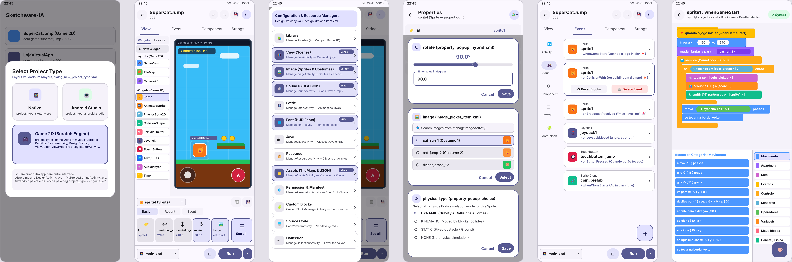
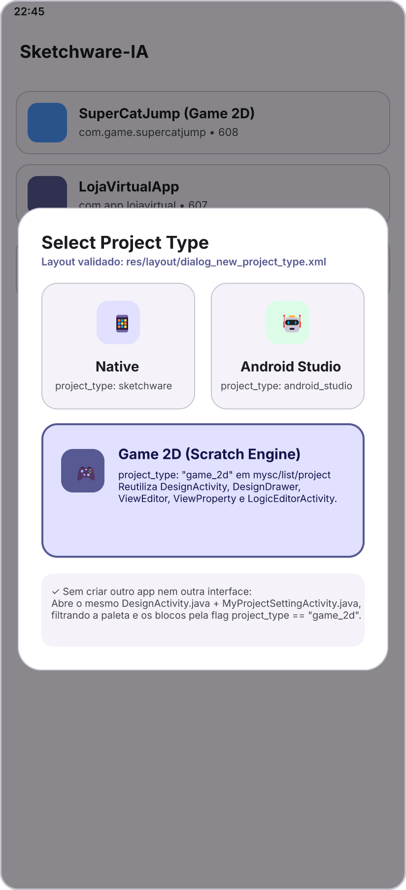
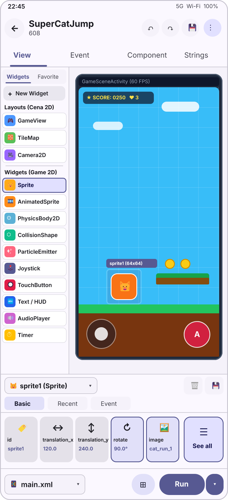
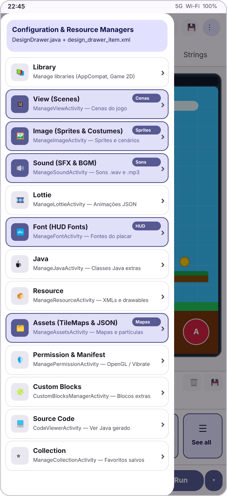
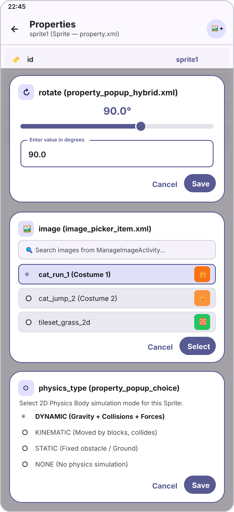
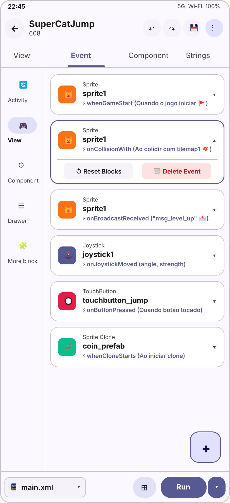
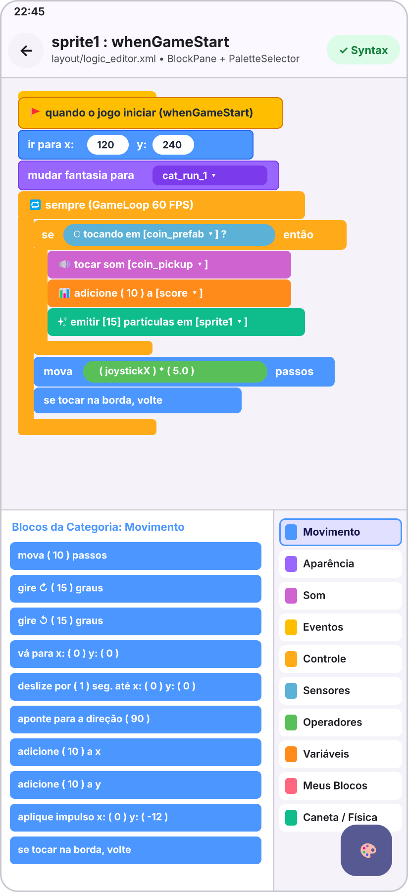

# Atualização: Motor de Jogos 2D Integrado ao Sketchware-IA (Inspirado no Scratch 3)

Esta pasta reúne toda a especificação técnica, o mapeamento dos layouts XML validados do **Sketchware-IA**, o projeto editável do **OpenCraft (FigCraft)** e as renderizações das telas para a implementação do 3º tipo de projeto: **Game 2D (`project_type = "game_2d"`)**.

---

## Estrutura desta Pasta

| Caminho | Descrição |
| :--- | :--- |
| [`README.md`](./README.md) | Visão geral da atualização, mapeamento dos layouts XML nativos e galeria das 6 telas. |
| [`ARQUITETURA_MOTOR_GAME_2D_SCRATCH.md`](./ARQUITETURA_MOTOR_GAME_2D_SCRATCH.md) | Documento técnico completo (arquitetura do motor 2D, classes do Sketchware-IA analisadas, `ViewBean`, `BlockBean`, 10 categorias de blocos Scratch 3, gerador Java `Jx`/`Fx` e compilador APK). |
| [`figcraft/Sketchware-IA - Motor Game 2D (Scratch 3).figcraft`](./figcraft/Sketchware-IA%20-%20Motor%20Game%202D%20(Scratch%203).figcraft) | Arquivo nativo editável no **OpenCraft (FigCraft)** contendo os 6 frames baseados nos layouts XML validados do Sketchware-IA. |
| [`figcraft/build_native_figcraft.js`](./figcraft/build_native_figcraft.js) | Script Node.js gerador dos comandos do FigCraft a partir das medidas e cores (`m3_colors.xml`) do Sketchware-IA. |
| [`figcraft/native_game2d_commands.json`](./figcraft/native_game2d_commands.json) | Script de comandos JSON executável via `figcraft-cli run`. |
| [`telas/`](./telas/) | Imagens PNG em alta resolução (`2x`) de cada uma das 6 telas e da visão geral do canvas. |

---

## Princípio Fundamental: Reutilização 100% dos Layouts Validados do Sketchware-IA

Para preservar integralmente o funcionamento dos projetos **Nativo (`sketchware`)** e **Android Studio (`android_studio`)** e economizar espaço de tela sem "reinventar a roda", o modo **Game 2D (`game_2d`)** reutiliza exatamente os mesmos layouts `.xml` e Activities já validados do Sketchware-IA:

1. **Seletor de Tipo de Projeto (`res/layout/dialog_new_project_type.xml`)**:
   - Reutiliza o diálogo chamado por `ProjectsFragment.java` (`showProjectTypeSelectionDialog()`) adicionando o 3º card **`Game 2D`** (`project_type = "game_2d"` em `mysc/list/<sc_id>/project` via `lC.java`).
2. **Editor Principal (`res/layout/design.xml` + `DesignActivity.java`)**:
   - Mantém a mesma `Toolbar`, `design_menu.xml`, `TabLayout` com as **4 abas nativas (`View`, `Event`, `Component`, `Strings`)** e a `bottom_bar` (`file_name_container` `main.xml`, `btn_canvas_tools` e `MaterialSplitButton` `Run`).
3. **Menu Lateral de Recursos (`DesignDrawer.java` + `res/layout/design_drawer_item.xml`)**:
   - Em vez de criar abas extras que ocupam espaço, usa o **menu lateral (`DesignDrawer`)** já existente no Sketchware-IA para gerenciar todos os recursos do jogo:
     - **View (`ManageViewActivity`)**: Cenas e fases do jogo.
     - **Image (`ManageImageActivity`)**: Importação de sprites, fantasias (*costumes*), tilesets e cenários.
     - **Sound (`ManageSoundActivity`)**: Importação de efeitos sonoros (`.wav`) e músicas (`.mp3` / `.ogg`).
     - **Lottie (`ManageLottieActivity`)**: Animações vetoriais JSON.
     - **Font (`ManageFontActivity`)**: Fontes arcade/pixel para HUD e placar.
     - **Assets (`ManageAssetsActivity`)**: Mapas TileMap (`.json`/`.tmx`) e partículas.
4. **Editor Visual e Painel de Propriedades (`res/layout/view_editor.xml`, `res/layout/palette_widget.xml`, `res/layout/view_property.xml` e `res/layout/property_grid_item.xml`)**:
   - Paleta esquerda de `120dp` com abas `Widgets | Favorite`, botão `+ New Widget` e os 13 componentes de jogos 2D (`GameView`, `TileMap`, `Camera2D`, `Sprite`, `AnimatedSprite`, `PhysicsBody2D`, `CollisionShape`, `ParticleEmitter`, `Joystick`, `TouchButton`, `Text / HUD`, `AudioPlayer`, `Timer`).
   - Painel inferior `ViewProperty` (`170dp` de altura) com seletor `spn_widget`, `img_delete`, `img_save`, grupos `Basic | Recent | Event`, cards horizontais de `80dp × 80dp` (`property_grid_item.xml`) e botão flutuante **`See all`** à direita.
5. **Diálogos Nativos de Edição de Propriedades (`res/layout/property_popup_hybrid.xml`, `res/layout/image_picker_item.xml`, `res/layout/property_popup_choice_attribute.xml` e `res/layout/property.xml`)**:
   - Ao clicar em qualquer card do `ViewProperty` ou abrir o `See all` (`PropertyActivity`), utiliza os mesmos diálogos `MaterialAlertDialogBuilder` do Sketchware-IA:
     - `PropertyInputItem.java` (`property_popup_hybrid.xml`): Slider Material 3 + `TextInputLayout` para `rotate`, `alpha`, `translation_x`, `translation_y`, `scale_x`, `scale_y`, `speed`, `gravity`.
     - `PropertyResourceItem.java` (`image_picker_item.xml`): Seletor com busca, `RadioButton` e miniatura das imagens importadas no `ManageImageActivity`.
     - `PropertyAttributeItem.java` (`property_popup_choice_attribute.xml`): `RadioGroup` para `physics_type` (`DYNAMIC`, `KINEMATIC`, `STATIC`, `NONE`), `rotation_style` e `layer`.
6. **Aba Event (`res/layout/fr_logic_list.xml` + `res/layout/fr_logic_list_item.xml`) e Editor de Blocos Scratch 3 (`res/layout/logic_editor.xml`)**:
   - Mantém a `NavigationRailView` (`Activity`, `View`, `Component`, `Drawer`, `More block`) e os cards `fr_logic_list_item.xml` na aba `Event`.
   - Mantém o `LogicEditorActivity.java` (`logic_editor.xml`) com `BlockPane` superior, `area_palette` inferior esquerdo e `PaletteSelector` (`right_drawer`) exibindo as **10 categorias oficiais do Scratch 3** (`Movimento`, `Aparência`, `Som`, `Eventos`, `Controle`, `Sensores`, `Operadores`, `Variáveis`, `Meus Blocos`, `Caneta / Física`).

---

## Galeria das Telas Validados (OpenCraft / FigCraft)

### Visão Geral Completa

---

### 01 — Seleção do Tipo de Projeto (`dialog_new_project_type.xml`)

---

### 02 — `DesignActivity` + `ViewEditor` + `ViewProperty` (`view_editor.xml` & `view_property.xml`)

---

### 03 — Menu Lateral Nativo (`DesignDrawer.java` + `design_drawer_item.xml`)

---

### 04 — Diálogos de Propriedades Nativos (`property_popup_hybrid.xml`, `image_picker_item.xml`, `property_popup_choice_attribute.xml` e `property.xml`)

---

### 05 — Aba `Event` Nativa (`rs.java` + `fr_logic_list.xml` + `fr_logic_list_item.xml`)

---

### 06 — `LogicEditorActivity` com as 10 Categorias do Scratch 3 (`logic_editor.xml` + `PaletteSelector.java`)

